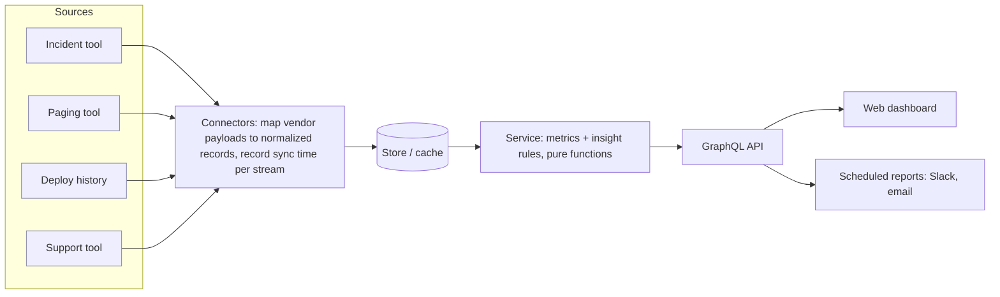

# Reliability insights platform: blueprint

A from-scratch design for a dashboard that shows engineering teams and their
leaders how reliable their services are and what their operational load costs,
built on public tools. The working reference implementation is in this repo;
this document is the reasoning behind it and the plan for growing it.

## 1. What it answers

| Who | Question | Where |
|---|---|---|
| Team lead | Are we getting better or worse, and what should we fix this week? | Insights, trends |
| On-call engineer | Which alerts wake us up for nothing? | On-call, noisiest alerts |
| Engineering leader | How do my orgs compare, and where is the risk? | Org rollups, insights |
| SRE | Which teams need help, and is the data trustworthy? | Coverage and staleness |

Design rule: every screen answers "so what?". A number with no comparison, target,
or action is noise. Put details behind a toggle with a one-line takeaway, let
color carry severity, and never show the same number twice on one screen.

## 2. Architecture

| Layer | Reference implementation | Production choice |
|---|---|---|
| Connectors | `sources/fixtures.py` (JSON) behind the `DataSource` protocol | One module per vendor, same protocol |
| Store | none, reads per request | Postgres (or your warehouse) holding normalized records plus a `sync_state` table; nightly precompute for expensive joins |
| Service | `service.py`, `metrics.py`, `insights.py` | Same, unchanged |
| API | FastAPI + Strawberry GraphQL | Same; behind the company's SSO proxy |
| Web | React 19 + Vite + Apollo Client 4 + GraphQL Codegen | Same, or the company's UI framework |

Why GraphQL: one request returns exactly the panels a page needs, the schema is a
typed contract both sides generate from, and adding a panel doesn't need a new
endpoint. The cost is the nullability trap in section 6; the repo's tests
exist to contain it.

## 3. Metric definitions

Conventions for every metric:
- **Medians and p90s, not means.** One three-day incident dominates a mean.
- **Too few samples is null, not 0**, returned with `sampleSize` so the UI can say
  "Not enough data". Default minimum: 3.
- **Open items are excluded from durations and counted separately.** Dropping them
  silently makes a team that never closes anything look fast.
- **Fixed windows `[start, end)` with explicit dates.** Rolling "last N days"
  windows move between two reads and manufacture fake changes. The UI's default is
  the last 4 complete ISO weeks.
- **Edge weeks are flagged partial.** They always understate; compare complete weeks.
- **Percent change needs a minimum sample and a minimum delta** before it becomes an
  insight, so 2 to 3 incidents never headlines as "50% worse".

| Metric | Definition | Includes | Watch out for |
|---|---|---|---|
| Incidents | Count by severity, by `started_at` in window | All severities | Severity drift: teams downgrade to look better. Show SEV mix, not just totals |
| Time to detect (MTTD) | `detected_at - started_at` | Incidents with a known detection time | `started_at` is often backdated in review; detection looks slower after review, and that is correct |
| Time to resolve (MTTR) | `resolved_at - started_at` | Resolved incidents | Define "resolved" as impact ended, not ticket closed. Report open count next to it |
| Deploys | Production deploys in window | All services in the org | Count deploys, not commits or builds |
| Change failure rate | Deploys linked to an incident / deploys | Distinct failed deploys | Needs the incident tool to record the causing deploy. Null with no deploys |
| Lead time for changes | Median `deployed_at - committed_at` | Deploys with a commit time | Use the first commit in the change, not the merge |
| Deploy frequency | Deploys per day for the median service | Services that deployed in the window | Per service, because DORA's levels describe one service; an org total grows with headcount. Services with no deploys are invisible |
| Failed deployment recovery time | Median `resolved_at - started_at` | Resolved incidents a deploy caused | DORA's renamed "time to restore". Few samples per window; often null |
| DORA levels | The 2024 report's levels whose range contains the value | Lead time, deploy frequency, recovery time | Survey clusters, not targets. Ranges overlap (recovery: High and Medium) and leave gaps (recovery between 1 day and 1 week) |
| Pages | Pages fired in window | All alerts routed to the org | Dedupe re-notifications of the same alert |
| Off-hours pages | Weekend, or outside 09:00 to 18:00 in the responder's timezone | Pages | Use the responder's timezone, not UTC. The reference uses the timestamp's own offset |
| Pages by hour | Count per weekday and hour | Pages | Same local time as off-hours, so a night hotspot means the responder's night |
| Actionable share | Pages marked actionable / pages marked at all | Pages with a responder verdict | Unmarked is unknown, never "not actionable" |
| Support requests | Requests opened in window | Human-originated threads | Exclude bot traffic at the connector. It can be close to half of all messages |
| First response | `first_human_response_at - opened_at` | Requests with a human reply | Bots and auto-acks are not responses. A reply from someone not registered as an agent still is |
| Resolution rate | Closed / all | All requests | Measures closing discipline as much as support quality. Agree on what "closed" means before setting a target |
| Error budget | `1 - bad / ((1 - objective) x total)` over the SLO's own window ending at `end` | Daily good and total counts | Burn rate = `(bad / total) / (1 - objective)`. BURNING at a 3-day rate >= 1, adapted from the SRE Workbook's ticket alert; daily data can't support its sub-day page alerts |

## 4. Data and connectors

### Normalized records (`models.py`)

`Incident`, `Deploy`, `Page`, `SupportRequest`, `Org`, `Slo`, `SliDaily`. Vendor fields stop at the
connector. Keep `None` meaning "unknown"; never encode unknown as `False` or `0`.

### Writing a connector

Implement `DataSource` (`sources/base.py`). Requirements:

1. **Paginate** to the end; assert the count when the API reports a total.
2. **Explicit timeouts**, and retry only on 429 and 5xx with backoff. Check your
   HTTP client's retry defaults (and any company wrapper around it): one that retries
   every 4xx turns a 404 into four calls and one timeout into four. Set the retry
   policy yourself.
3. **Record a sync timestamp per stream** (`coverage()`), on success only. The
   service marks a stream stale after 26 hours, and a stream that has never
   synced as stale too. A stopped sync must never read as a confident zero.
4. **Map ownership explicitly.** Which org owns a channel, alert, or service should
   come from a service catalog, with an override table for corrections. Without an
   override path, every attribution fix becomes a catalog change in someone else's
   system.
5. **Detect dead inputs.** A channel or alert source that existed once but produces
   nothing now looks identical to a quiet one. Track last-seen time per input, not
   only per stream.
6. **Exclude bots** at this layer, by account type or an allowlist, and document how.

Common vendors (verify field names against their current API docs before building;
none of these adapters is in the reference code):

| Data | Typical sources | Notes |
|---|---|---|
| Incidents | incident.io, PagerDuty, FireHydrant, Jira Service Management | Prefer the tool's own impact-start and resolved timestamps over ticket timestamps |
| Pages | PagerDuty, Opsgenie, incident.io On-call | Pull log entries or notifications to get acknowledgements and responders |
| Deploys | GitHub Deployments, Argo CD, Spinnaker, your CD system | Production environment only |
| Support | A Slack ticketing tool, Zendesk, Jira Service Management | Teams split across tools: plan for more than one connector, or the org shows "no coverage" forever |

### Orgs and rollups

Orgs form a tree. A parent's numbers are the **deduplicated union** of its
subtree (`service.scope()`): an item tagged with two orgs in the subtree counts
once. A parent with no sources of its own inherits its children's staleness.
Test that `parent == sum(children)` when no item is shared, and less when items are.

## 5. Performance

- Fixed windows make results cacheable: key the cache on `(org, start, end, schema version)`.
- **Precompute** anything that joins large tables per org (for example, matching
  support responders against team rosters). Joins that take tens of seconds per
  org belong in a nightly job, never in the request path.
- Guard against huge scopes: refuse or paginate an org whose subtree exceeds a set
  size, rather than timing out.
- Bound each request: windows are at most 366 days and a query at most 10 aliases
  (`service.py`, `schema.py`). Unexpected errors reach clients as "Unexpected error."
  and stay in the server log.
- Each org and window is computed once per request, however many aliases or parents
  (`children`) select it.
- Don't loop uncached queries across all orgs against production sources from a laptop.

## 6. The schema contract

The single most expensive class of bug in this kind of system is a **schema
mismatch between deployed backend and deployed frontend**. In GraphQL:

- A query that selects a field the server doesn't have fails **the whole
  operation**, not just that field.
- A **non-null** field that errors or resolves to null nulls its parent object,
  bubbling up until it reaches a nullable field, possibly the entire `data`.

Rules, and how this repo enforces them:

| Rule | Enforced by |
|---|---|
| Committed SDL matches the code | `test_committed_schema_matches_code`, CI diff |
| Frontend types match the SDL | CI runs codegen and diffs `src/gql` |
| New fields are nullable | `test_no_unreviewed_non_null_fields` against `schema/non_null_fields.txt` |
| No breaking change vs. main | `scripts/check_breaking.py` in CI (graphql-core `find_breaking_changes`) |
| Frontend merges after backend is in prod | Process. Check prod with a real request before merging the frontend PR |

Note: graphql-core does **not** count an output field going nullable to non-null
as breaking (it's type-safe for clients). It is a runtime risk, which is why the
non-null budget is a separate test.

**Saved or snapshotted data:** if you store rendered results (saved reviews,
reports), every type in a stored payload must stay nullable forever, because old
snapshots don't have the new field and can't be backfilled by a cache bump.
Version stored payloads and test restoring an old one.

**Deploy order** for a field the frontend needs:

1. Backend PR adds the field (nullable). Merge, deploy to production.
2. Verify in production: send the real query, several times, from outside the
   service. During a rollout some instances have the field and some don't.
3. Frontend PR selects the field. Merge only now.

A feature flag hiding the panel does **not** protect you: the query still selects
the field, and the whole query fails.

## 7. Security and access

- Put the API behind the company's SSO proxy; read the caller from trusted
  headers or a verified token in `create_app`'s context.
- Authorize per org: filter `orgs` and refuse `orgMetrics` for orgs the caller
  can't see.
- **Read-only until ownership is enforced.** If you later add actions (accept a
  recommendation, change an alert), allow them only for the owners of the thing
  being changed, and audit who did it and through which client.
- Store the minimum personal data: responder IDs for joins, not message content.

## 8. Testing strategy

| Layer | What to test | Here |
|---|---|---|
| Metric rules | Edge cases: empty, too few samples, open items, negative durations, partial weeks | `test_metrics.py` |
| Insight rules | Thresholds: silent below the minimum change or sample | `test_insights.py` |
| Service | Rollups, dedupe, staleness, bad windows | `test_service.py` |
| API | Real HTTP through FastAPI: shapes, nulls, errors that don't null siblings | `test_graphql.py` |
| Contract | Drift, non-null budget, breaking changes | `test_schema_contract.py`, `check_breaking.py` |
| Demo data | The generator reproduces the committed file; each story beat shows through the service | `test_demo_data.py`, `test_export_demo.py` |
| UI | Each section's render, empty, and failed state; charts by keyboard and as tables; axe | `frontend/src/*.test.ts(x)` |
| Reality | The query you changed, against the running API and real sources, across several orgs | Manual before every PR (`make api`) |

Two rules that matter more than coverage:
- **A test that passes before and after the fix proves nothing.** Run new tests
  against the broken code first and watch them fail.
- **Mocked clients prove request shape, not acceptance.** A full green suite can
  pass a query the real backend rejects. Probe the real source before merging any
  change to a query.

## 9. Operating it

- Emit, per stream: last successful sync, records synced, errors. Alert on a stale
  stream, not just on failures, because a sync that silently returns nothing never
  fails.
- Dashboards about dashboards are cheap insurance: track page load, query latency,
  and the share of panels showing "Not enough data".
- Reconcile against an external report with **fixed** windows. Sliding windows
  manufacture small differences that look like bugs.

## 10. Rollout

1. **Pilot** with one or two teams who want it. Weekly feedback.
2. **Ops review integration:** the weekly ops review agenda reads from the dashboard.
3. **Expand by org**, with a coverage view first: which teams have each source
   connected. Teams on a tool you don't support yet show "no coverage", not zeros.
4. **Scheduled reports** (Slack, email) once the numbers are trusted.
5. **Targets** only after a baseline period, and only for metrics people agree measure
   what they think.

## 11. Roadmap

| Phase | Scope |
|---|---|
| 0. Reference (this repo) | Seeded demo data, delivery (DORA), incident, on-call, and SLO metrics, contract tests, dashboard, static demo |
| 1. First real source | One incident-tool connector, Postgres store, sync state, staleness alerts |
| 2. Coverage | Pages and deploys; coverage view; org tree from the service catalog with overrides |
| 3. Support | Support connector with bot exclusion; first-response and resolution with caveats |
| 4. Reports | Saved reviews (versioned, nullable payloads), scheduled Slack summaries |
| 5. Recommendations | Read-only suggestions (noisy alert, slow detection); actions only with ownership checks |

## 12. Lessons that generalize

1. A stopped data source must look stale, not quiet. Track freshness per stream and
   per input.
2. Too few samples is null. Open items are counted. Windows are fixed.
3. Low resolution rates are often a marking problem, not a support problem. Find out
   how people close things before setting targets.
4. "Open" or "responded" flags in vendor tools often miss replies from people who
   aren't registered agents. Don't automate on them without checking.
5. Every new field is nullable. Frontend merges after backend is in prod. Flags don't
   protect queries.
6. Precompute expensive joins; keep the request path cheap.
7. Probe the running system with several real inputs before merging; defects that
   depend on the input never show with one.
8. Leader-facing screens: one takeaway per section, details collapsed, color for
   severity, no repeated numbers, plain short copy.
