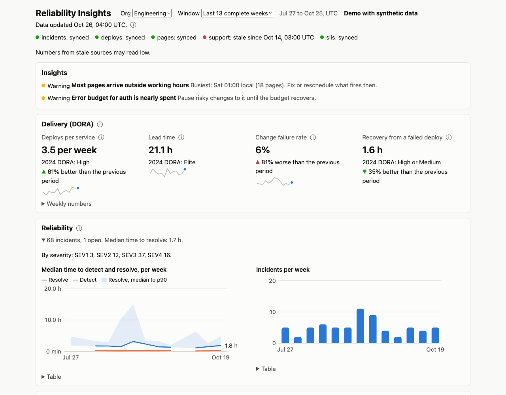
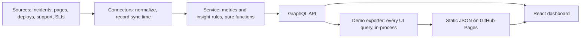

# Reliability Insights

A reliability dashboard for engineering teams and their leaders: DORA delivery
metrics, incidents, on-call load, SLO error budgets, and team comparisons, with
rule-based insights and data-freshness checks.

**[Live demo](https://dbbuilds.github.io/reliability-insights-platform/)**: 26 weeks
of synthetic data for five teams. The real backend computes every number at build
time; the page is static. **[A 5-minute tour](docs/tour.md)** shows what to click.

<picture>
  <source media="(prefers-color-scheme: dark)" srcset="docs/images/dashboard-dark.png">
  
</picture>

## What to look for in the demo

Pick **Engineering** and **Last 13 complete weeks**, then open each team from the
Teams table, or follow the [tour](docs/tour.md).

| Team | Story | Where it shows |
|---|---|---|
| Checkout | A risky release mid-quarter | Change failure rate spike insight; SEV2s |
| Payments | Time to resolve falls steadily | "Median time to resolve down" insight |
| Search | Paged at night; support sync stopped | Off-hours insight and heatmap; stale badge |
| Platform | One alert dominates and is rarely actionable | Noisy-alert insight; one open incident |
| Identity | Most of an SLO's budget burned early | Error-budget insight; burn-down chart |

## How it works



| Part | Stack |
|---|---|
| `backend/` | Python 3.11+, FastAPI, Strawberry GraphQL, uv |
| `frontend/` | Node 22.12+, React 19, Vite 8, Apollo Client 4, GraphQL Codegen, hand-written SVG charts |
| `schema/` | The GraphQL contract (generated, committed) and the reviewed non-null field list |
| `scripts/` | Breaking-change check, GitHub Pages publishing |

[BLUEPRINT.md](BLUEPRINT.md) has the design, every metric's definition and caveats,
and the roadmap.

## Quick start

Prerequisites: [uv](https://docs.astral.sh/uv/) and Node 22.12 or newer.

| Platform | Install |
|---|---|
| macOS, Homebrew | `brew install uv node` (the current Node; 22 is what's verified) |
| macOS, MacPorts | `sudo port install uv nodejs22` |
| Any, mise | `mise use uv node@22` |
| Linux | uv: `curl -LsSf https://astral.sh/uv/install.sh \| sh`; Node 22 from your distribution, nvm, or mise |

```bash
git clone https://github.com/DBBuilds/reliability-insights-platform.git
cd reliability-insights-platform
make setup   # backend and frontend dependencies from the lockfiles
make demo    # API on the demo data plus the UI: http://localhost:5173
```

| Command | Does |
|---|---|
| `make check` | Lint, typecheck, all tests, contract drift, production build (the steps CI runs) |
| `make api` / `make web` | API on :8000 (GraphiQL at `/graphql`) and UI on :5173, separately |
| `make demo-build` | The static demo in `frontend/dist`, no API needed |
| `make demo-data` | Regenerate the seeded demo data (same bytes every run) |
| `make schema` | Regenerate the contract and the frontend types after a schema change |

## Rules this code keeps

- **Too few samples is null, never 0.** Open items are counted, not dropped.
- **A source that stopped syncing shows as stale,** never as a confident zero.
- **Windows are fixed dates** (complete ISO weeks), so numbers don't drift between reads.
- **New schema fields are nullable,** and a frontend query selects a new field only
  after the backend serving it is live. Tests and CI enforce the contract.
- **Every metric definition has a test that failed before it changed.**

Contributor rules are in [CONTRIBUTING.md](CONTRIBUTING.md).

## Verified on

| Platform | Date | Versions |
|---|---|---|
| macOS 26.7 (Intel, x86_64) | 2026-10-31 | uv 0.13.1, Node 22.22.2, Python 3.12.15 |
| Linux (GitHub Actions, ubuntu-latest) | Every push and PR | Python 3.12.3, Node 22.23.4 |
| macOS (Apple Silicon) | 2026-10-14, earlier version | Not re-verified since |

`make check` passes on the first two. Known advisories (2026-10-31): runtime dependencies
have none (`npm audit --omit=dev`, `pip-audit`). The development toolchain has one
moderate `minimatch` advisory, reached only through `@graphql-codegen/cli`, with no
fixed release yet; it doesn't ship in the built app.

## Roadmap

1. Real connectors (an incident tool first) and a Postgres store with sync state.
2. Authentication from an SSO proxy, with per-org access.
3. An AI-written weekly ops summary, checked number by number against the API.
4. Scheduled reports (Slack, email).

BLUEPRINT.md section 11 has the full product roadmap.

## License

[MIT](LICENSE)
